# 📋 Diagrama de Flujo: Registro y Ejecución de Servicio de Transporte

## Sistema: TransporteVadexa CRM

---

## Diagrama en Mermaid

```mermaid
flowchart TD
    Start([Inicio]) --> Login[Ingresar al Sistema]
    Login --> Dashboard[Acceder al Dashboard Principal]
    Dashboard --> Select[Seleccionar opción<br/>Registrar Nuevo Servicio]
    Select --> Form[Completar Datos del Servicio<br/>• Fecha y hora<br/>• Cliente<br/>• Ruta<br/>• Vehículo<br/>• Conductor<br/>• Monto del servicio]
    Form --> Validate[Validar Disponibilidad<br/>de Vehículo y Conductor]
    
    Validate --> Decision{¿Existe Conflicto<br/>de Horario?}
    
    Decision -->|Sí| Error[Mostrar Mensaje de Conflicto<br/>Vehículo o Conductor Ocupado]
    Error --> Form
    
    Decision -->|No| Calculate[Calcular IGV,<br/>Base Imponible<br/>y Utilidad Estimada]
    Calculate --> Generate[Generar Guía de<br/>Remisión Transportista GRT<br/>y Comprobante F001/B001]
    Generate --> Register[Registrar Servicio<br/>en la Base de Datos]
    Register --> SetStatus1[Asignar Estado:<br/>Programado]
    SetStatus1 --> ViewAgenda[Visualizar Servicio<br/>en la Programación Diaria]
    ViewAgenda --> StartService[Iniciar el Servicio<br/>Despacho]
    StartService --> SetStatus2[Cambiar Estado a:<br/>En Ruta]
    SetStatus2 --> Transport[Realizar el Transporte]
    Transport --> Complete[Completar el Servicio]
    Complete --> SetStatus3[Cambiar Estado a:<br/>Finalizado]
    SetStatus3 --> End([Fin])

    style Start fill:#4CAF50,stroke:#2E7D32,stroke-width:3px,color:#fff
    style End fill:#f44336,stroke:#c62828,stroke-width:3px,color:#fff
    style Decision fill:#FFC107,stroke:#F57C00,stroke-width:2px
    style Error fill:#FFCDD2,stroke:#e57373,stroke-width:2px
    style Login fill:#E3F2FD,stroke:#1976D2,stroke-width:2px
    style Dashboard fill:#E3F2FD,stroke:#1976D2,stroke-width:2px
    style Select fill:#E3F2FD,stroke:#1976D2,stroke-width:2px
    style Form fill:#E3F2FD,stroke:#1976D2,stroke-width:2px
    style Validate fill:#FFF9C4,stroke:#F9A825,stroke-width:2px
    style Calculate fill:#C8E6C9,stroke:#43A047,stroke-width:2px
    style Generate fill:#C8E6C9,stroke:#43A047,stroke-width:2px
    style Register fill:#C8E6C9,stroke:#43A047,stroke-width:2px
    style SetStatus1 fill:#B3E5FC,stroke:#0277BD,stroke-width:2px
    style ViewAgenda fill:#B3E5FC,stroke:#0277BD,stroke-width:2px
    style StartService fill:#BBDEFB,stroke:#1976D2,stroke-width:2px
    style SetStatus2 fill:#BBDEFB,stroke:#1976D2,stroke-width:2px
    style Transport fill:#BBDEFB,stroke:#1976D2,stroke-width:2px
    style Complete fill:#BBDEFB,stroke:#1976D2,stroke-width:2px
    style SetStatus3 fill:#BBDEFB,stroke:#1976D2,stroke-width:2px
```



---

## Descripción del Flujo

### Fase 1: Acceso al Sistema
1. **Ingresar al Sistema** - El usuario accede con sus credenciales validadas
2. **Acceder al Dashboard Principal** - Visualiza el panel de control
3. **Seleccionar "Registrar Nuevo Servicio"** - Inicia el proceso de registro

### Fase 2: Captura de Información
4. **Completar Datos del Servicio**
   - Fecha y hora del servicio
   - Cliente solicitante
   - Ruta de transporte
   - Vehículo asignado
   - Conductor asignado
   - Monto del servicio

### Fase 3: Validación
5. **Validar Disponibilidad** - El sistema verifica que el vehículo y conductor estén disponibles
6. **Decisión: ¿Existe Conflicto de Horario?**
   - **SÍ**: Muestra mensaje de error y regresa al formulario
   - **NO**: Continúa con el proceso

### Fase 4: Cálculo y Generación de Documentos
7. **Calcular IGV, Base Imponible y Utilidad** - El sistema calcula automáticamente los montos
8. **Generar GRT y Comprobante** - Crea la documentación legal requerida (F001/B001)

### Fase 5: Registro
9. **Registrar Servicio** - Almacena toda la información en la base de datos
10. **Asignar Estado: "Programado"** - El servicio queda en estado inicial

### Fase 6: Programación y Visualización
11. **Visualizar en Programación Diaria** - El servicio aparece en la agenda del día

### Fase 7: Ejecución del Servicio
12. **Iniciar el Servicio (Despacho)** - El conductor inicia el servicio
13. **Cambiar Estado a: "En Ruta"** - Estado actualizado
14. **Realizar el Transporte** - Ejecución del servicio
15. **Completar el Servicio** - Finalización del transporte
16. **Cambiar Estado a: "Finalizado"** - Estado final

---

## Leyenda de Colores

| Color | Significado | Procesos |
|-------|-------------|----------|
| 🟦 Azul Claro | Procesos de Entrada | Ingresar, Acceder, Seleccionar, Formulario |
| 🟨 Amarillo | Validación | Validar Disponibilidad |
| 🟧 Naranja | Decisión | ¿Existe Conflicto? |
| 🟥 Rojo Claro | Error | Mensaje de Conflicto |
| 🟩 Verde Claro | Cálculo y Registro | Calcular, Generar, Registrar |
| 🔷 Azul Medio | Estados | Programado, En Ruta, Finalizado |
| 🟢 Verde Oscuro | Inicio | Punto de entrada |
| 🔴 Rojo Oscuro | Fin | Punto de salida |

---

## Estados del Servicio

```
PROGRAMADO → EN RUTA → FINALIZADO
```

### Estado: Programado
- Servicio registrado pero no iniciado
- Aparece en la agenda diaria
- Conductor y vehículo asignados

### Estado: En Ruta
- Servicio en ejecución
- Conductor ha iniciado el despacho
- Transporte en progreso

### Estado: Finalizado
- Servicio completado exitosamente
- Documentación generada
- Listo para facturación

---

## Validaciones del Sistema

### ✅ Validación de Disponibilidad
El sistema verifica:
- ✓ Vehículo no esté asignado en el mismo horario
- ✓ Conductor no tenga otro servicio simultáneo
- ✓ Vehículo esté en condiciones operativas
- ✓ Conductor tenga licencia vigente

### ❌ Casos de Conflicto
- Vehículo ocupado en el horario solicitado
- Conductor con servicio simultáneo
- Recursos no disponibles

---

## Documentos Generados

### 📄 GRT (Guía de Remisión Transportista)
- Documento legal obligatorio
- Número correlativo automático
- Información del transportista, remitente y destinatario

### 🧾 Comprobante de Pago
- **F001**: Factura (empresas con RUC)
- **B001**: Boleta (personas naturales)
- IGV calculado automáticamente (18%)

---

## Notas Técnicas

- **Base de Datos**: PostgreSQL (Supabase)
- **Backend**: FastAPI (Python)
- **Frontend**: React + TypeScript
- **Validación en Tiempo Real**: Verifica disponibilidad antes de guardar
- **Generación Automática**: Documentos PDF generados al registrar

---

## Mejoras Aplicadas vs Versión Original

### ❌ Versión Original (Problemas)
1. "Introducir credenciales" + "Validar credenciales" + "Ingresar" → Redundante
2. Lógica if/else para credenciales → Fuera de contexto
3. "Enviar POST al backend" → Detalle técnico innecesario
4. "Completar datos del servicio" sin desglose claro
5. "Acceder" como proceso separado → Confuso

### ✅ Versión Mejorada
1. Un solo paso: "Ingresar al Sistema" → Simplificado
2. Sin lógica de credenciales → Ya está autenticado
3. "Validar Disponibilidad" → Lenguaje simple
4. Datos del servicio en lista clara dentro del proceso
5. Flujo lineal y comprensible

---

## Autor
**Sistema CRM TransporteVadexa**  
Versión 2.0 - Septiembre 2026

---

