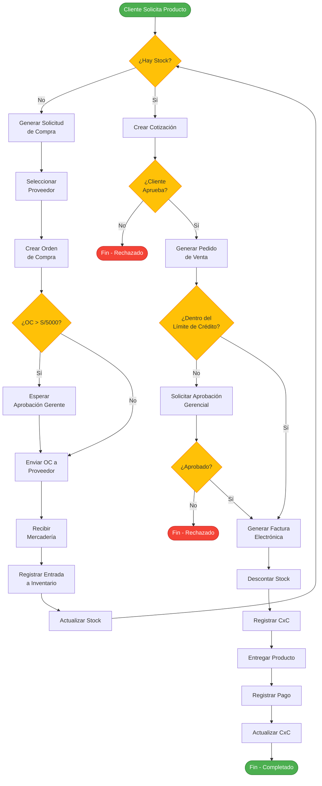

# 🗺️ MAPA DE PROCESOS - ERP EnterpriseCloud

## Diagrama de Flujo de Procesos Principales



---

## Procesos por Módulo

### 1. PROCESO DE VENTAS

```
┌─────────────────────────────────────────────────────────────┐
│                    PROCESO DE VENTAS                         │
└─────────────────────────────────────────────────────────────┘

Cliente → Vendedor → Cotización → Aprobación → Pedido
                                                  ↓
                                        Verificar Stock
                                                  ↓
                                        Verificar Crédito
                                                  ↓
                                         Generar Factura
                                                  ↓
                                         Actualizar CxC
                                                  ↓
                                        Entregar Producto
                                                  ↓
                                        Registrar Cobro
                                                  ↓
                                           Completado
```

### 2. PROCESO DE COMPRAS

```
┌─────────────────────────────────────────────────────────────┐
│                    PROCESO DE COMPRAS                        │
└─────────────────────────────────────────────────────────────┘

Almacén → Solicitud Compra → Seleccionar Proveedor
                                      ↓
                              Crear Orden de Compra
                                      ↓
                          ¿Monto > S/5000? → [Sí] → Aprobación Gerente
                                      ↓ [No]
                              Enviar a Proveedor
                                      ↓
                              Recibir Mercadería
                                      ↓
                              Verificar Calidad/Cantidad
                                      ↓
                           Registrar Entrada a Inventario
                                      ↓
                              Registrar Factura Proveedor
                                      ↓
                              Actualizar CxP
                                      ↓
                              Programar Pago
```

### 3. PROCESO DE INVENTARIO

```
┌─────────────────────────────────────────────────────────────┐
│                  PROCESO DE INVENTARIO                       │
└─────────────────────────────────────────────────────────────┘

ENTRADAS (Compras)
    ↓
Registro de Entrada → Actualización de Stock → ¿Stock < Mínimo?
                                                        ↓ [Sí]
                                                   Generar Alerta
                                                        ↓
                                                Solicitud de Compra

SALIDAS (Ventas)
    ↓
Verificar Stock → Descontar → Actualizar → ¿Stock < Mínimo?
                                                   ↓ [Sí]
                                              Generar Alerta

AJUSTES
    ↓
Justificación → Aprobación → Registro → Actualizar Stock
```

### 4. PROCESO FINANCIERO

```
┌─────────────────────────────────────────────────────────────┐
│                  PROCESO FINANCIERO                          │
└─────────────────────────────────────────────────────────────┘

CUENTAS POR COBRAR:
Venta a Crédito → Registrar CxC → Fecha Vencimiento
                                          ↓
                                   Seguimiento
                                          ↓
                                   Registro de Cobro
                                          ↓
                                   Actualizar CxC

CUENTAS POR PAGAR:
Compra a Crédito → Registrar CxP → Fecha Vencimiento
                                          ↓
                                   Programar Pago
                                          ↓
                                   Registro de Pago
                                          ↓
                                   Actualizar CxP

CAJA Y BANCOS:
Ingreso/Egreso → Registro en Sistema → Actualizar Saldo
                                              ↓
                                      Conciliación Mensual
                                              ↓
                                      Cierre Contable
```

---

## Matriz de Interacción entre Módulos

```
┌────────────┬──────┬────────┬───────────┬─────────┬──────────┐
│   Módulo   │Ventas│Compras │Inventario │Finanzas │Documentos│
├────────────┼──────┼────────┼───────────┼─────────┼──────────┤
│  Ventas    │  -   │   →    │    ↔↔     │   ↔↔    │    →     │
├────────────┼──────┼────────┼───────────┼─────────┼──────────┤
│  Compras   │  ←   │   -    │    ↔↔     │   ↔↔    │    →     │
├────────────┼──────┼────────┼───────────┼─────────┼──────────┤
│ Inventario │  ↔↔  │   ↔↔   │     -     │   →     │    ←     │
├────────────┼──────┼────────┼───────────┼─────────┼──────────┤
│  Finanzas  │  ↔↔  │   ↔↔   │     ←     │    -    │    →     │
├────────────┼──────┼────────┼───────────┼─────────┼──────────┤
│ Documentos │  ←   │   ←    │     →     │   ←     │    -     │
└────────────┴──────┴────────┴───────────┴─────────┴──────────┘

Leyenda:
→  : Envía datos
←  : Recibe datos
↔↔ : Interacción bidireccional fuerte
```

---

## Estados de Documentos

### COTIZACIÓN
```
PENDIENTE → EN REVISIÓN → APROBADA → CONVERTIDA A PEDIDO
              ↓
           RECHAZADA (fin)
```

### ORDEN DE COMPRA
```
BORRADOR → PENDIENTE APROBACIÓN → APROBADA → ENVIADA
                                      ↓
                                  RECIBIDA → CERRADA
```

### PEDIDO DE VENTA
```
NUEVO → EN PROCESO → PREPARADO → FACTURADO → ENTREGADO
```

### FACTURA
```
GENERADA → PENDIENTE PAGO → PAGADA PARCIAL → PAGADA TOTAL
```

---

## Diagrama de Contexto del Sistema

```
                    ┌──────────────────────┐
                    │                      │
              ┌────▶│      CLIENTE         │◀────┐
              │     │                      │     │
              │     └──────────────────────┘     │
              │                                  │
    Cotización│                                  │Confirmación
    Pedidos   │                                  │Facturas
              │                                  │
              │     ┌──────────────────────┐     │
              │     │                      │     │
              └─────│  ERP EnterpriseCloud │─────┘
                    │                      │
              ┌─────│   AWS Cloud System   │─────┐
              │     │                      │     │
              │     └──────────────────────┘     │
              │                                  │
    Órdenes   │                                  │Facturas
    de Compra │                                  │Pagos
              │                                  │
              │     ┌──────────────────────┐     │
              │     │                      │     │
              └────▶│     PROVEEDOR        │◀────┘
                    │                      │
                    └──────────────────────┘
```

---

## Flujo de Datos Principal

```
                    ENTRADA DE DATOS
                           ↓
    ┌──────────────────────────────────────────┐
    │         CAPA DE PRESENTACIÓN             │
    │          (React Frontend)                │
    └──────────────────────────────────────────┘
                           ↓
    ┌──────────────────────────────────────────┐
    │          CAPA DE NEGOCIO                 │
    │        (FastAPI Backend)                 │
    │  • Validación                            │
    │  • Lógica de Negocio                     │
    │  • Autenticación/Autorización            │
    └──────────────────────────────────────────┘
                           ↓
              ┌────────────┴────────────┐
              ↓                         ↓
    ┌─────────────────┐       ┌─────────────────┐
    │  POSTGRESQL     │       │    AWS S3       │
    │    (RDS)        │       │  (Documentos)   │
    │  • Transacciones│       │  • PDFs         │
    │  • Maestros     │       │  • Imágenes     │
    │  • Registros    │       │  • Archivos     │
    └─────────────────┘       └─────────────────┘
```

---

**Elaborado por:** Sistema Kiro AI  
**Fecha:** Septiembre 2026  
**Versión:** 1.0
